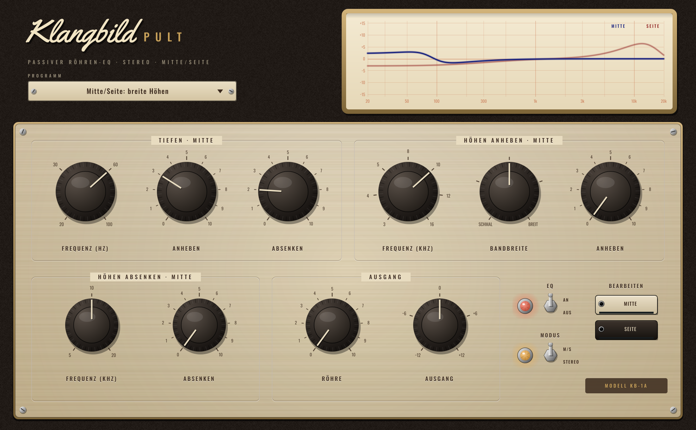

# Klangbild Pult

Passiver Röhren-EQ im Stil der klassischen Programm-Entzerrer aus den 50er/60er Jahren – breite, musikalische
Kurven, die man kaum „falsch“ einstellen kann, inklusive des berühmten **Tiefen-Tricks** (gleichzeitig anheben
und absenken). Wahlweise **Stereo** oder **Mitte/Seite** getrennt. Audio Unit für Logic Pro (außerdem VST3 und
Standalone), gebaut mit [JUCE](https://juce.com).



## Bedienung

| Gruppe | Regler |
|---|---|
| **Tiefen** | Frequenz 20 · 30 · 60 · 100 Hz – **Anheben** (bis +14 dB) – **Absenken** (bis −10 dB) |
| **Höhen anheben** | Frequenz 3 · 4 · 5 · 8 · 10 · 12 · 16 kHz – **Bandbreite** (schmal … breit) – **Anheben** (bis +16 dB) |
| **Höhen absenken** | Frequenz 5 · 10 · 20 kHz – **Absenken** (sanftes Kuhschwanz-Filter, bis −16 dB) |
| **Ausgang** | **Röhre** (Wärme, vor allem geradzahlige Obertöne, 2-fach überabgetastet) – **Ausgang** ±12 dB |
| **Schalter** | **EQ An/Aus** (zeitrichtiger Bypass) – **Modus Stereo / M/S** – **Bearbeiten Mitte / Seite** |

Oben zeigt das **Messprotokoll** den Frequenzgang der Einstellung (im M/S-Modus Mitte blau, Seite rot).

### Der Tiefen-Trick
Anheben und Absenken auf **derselben Frequenz** gleichzeitig: Die Anhebung wirkt tiefer und steiler, die Absenkung
flacher und etwas höher. Ergebnis: ein satter Bauch ganz unten **und** eine Delle darüber – mehr Fundament,
weniger Mulm. Beispiel 60 Hz, 5/5: **+3 dB bei 45–60 Hz, −3,7 dB bei 150 Hz**.

### Mitte/Seite
- **Mitte** = alles, was in der Mitte steht (Gesang, Bass, Bassdrum, Snare)
- **Seite** = der Raum und die Breite (Gitarren links/rechts, Hall, Overheads)

Typisch fürs Mastering: Tiefen nur in der Mitte, „Luft“ (Höhen) nur auf der Seite – der Mix wird breiter,
ohne dass der Gesang zischelt. Ein Mono-Signal bleibt dabei unberührt.

### Presets
Neutral · Bass-Trick 60 Hz · Kick & Bass satt · Gesang mit Luft · Akustikgitarre ·
E-Gitarre: Glanz statt Schärfe · Mastering sanft · Mitte/Seite: breite Höhen

## Messwerte (48 kHz)
| Einstellung | 30 Hz | 60 Hz | 150 Hz | 250 Hz |
|---|---|---|---|---|
| 60 Hz Anheben 10 | +14,9 | +13,9 | −0,8 | −1,0 |
| 60 Hz Absenken 10 | −9,6 | −8,8 | −6,0 | −4,0 |
| 60 Hz Trick 5/5 | +2,6 | +3,1 | −3,7 | −2,5 |

Höhen 10 kHz, Anheben 10: schmal +5,7 dB bei 8 kHz, breit +15 dB bei 8 kHz.
Röhre bei −6 dBFS: 25 % → k2 1,0 %, 100 % → k2 2,7 % / k3 1,9 %.
In Neutralstellung ist das Plugin bitgenau. Latenz 4 Samples (wird an Logic gemeldet).

## Installation in Logic Pro

Tab **Actions** → letzter grüner Lauf → **Artifacts** → `Klangbild-Pult-macOS`, dann:

1. `Klangbild-Pult-AU.zip` entpacken → `Klangbild Pult.component`
2. Finder → ⇧⌘G → `~/Library/Audio/Plug-Ins/Components` → Datei hineinkopieren
3. Einmal im Terminal:
   ```
   xattr -dr com.apple.quarantine ~/Library/Audio/Plug-Ins/Components/"Klangbild Pult.component"
   ```
4. Logic starten: **Audio Units → Klangbild → Klangbild Pult**

## Lizenzen

Schriften *Oswald* (OFL 1.1) und *Yellowtail* (Apache 2.0) – Lizenztexte in `Resources/`.
JUCE: AGPLv3 bzw. kommerziell – für den privaten Gebrauch unproblematisch.
